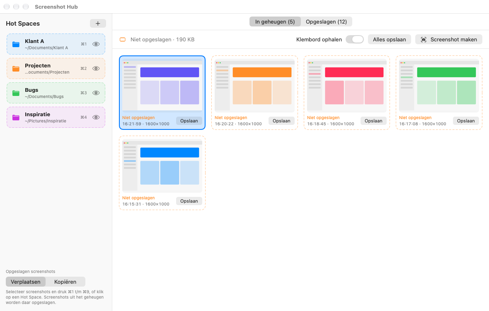

# Screenshot Hub

**Shoot first, store later.** Een kleine macOS-app waarin screenshots eerst in het geheugen komen. Pas als je ze opslaat worden het bestanden: in je screenshotmap of meteen in de juiste map via een Hot Space.



## Wat het doet

- **In geheugen**: screenshots die nog niet zijn opgeslagen.
  - Maak er een met de knop **Screenshot maken** (⌘N): kies een gebied, of druk op spatie voor een venster.
  - Of zet **Klembord ophalen** aan (standaard uit) en maak er een naar het klembord met ⌃⌘⇧4. Afbeeldingen die een app als vertrouwelijk of tijdelijk markeert, zoals uit een wachtwoordmanager, worden overgeslagen.
  - Opslaan kan per kaart, met ⌘S voor de selectie of met **Alles opslaan** (⌘⇧S).
- **Opgeslagen**: wat er in je screenshotmap staat. Die map kies je zelf, bijvoorbeeld de map die macOS gebruikt (te zien bij ⌘⇧5 › Opties).
- **Hot Spaces**: mappen in de zijbalk waar je screenshots naartoe stuurt.
  - Sleep een screenshot op een Hot Space, klik erop met een selectie, of druk ⌘1 t/m ⌘9.
  - Screenshots uit het geheugen worden daar opgeslagen. Opgeslagen screenshots worden verplaatst of gekopieerd, naar keuze.
  - Klik op een Hot Space zonder selectie, of op het oog, om te zien wat erin staat.
  - Hernoem of verplaats je de map in Finder, dan blijft de Hot Space gewoon werken.
- **Ongedaan maken**: na opslaan, verplaatsen, kopiëren of weggooien staat er een knop in de melding onderin.
- **Updatemelding**: de app kijkt één keer per dag of er een nieuwe versie op GitHub staat en meldt dat bovenin het venster, met een knop naar de release. Handmatig kan via **Screenshot Hub › Controleer op updates…**.
- **Veilig stoppen**: staan er nog screenshots in het geheugen, dan vraagt de app bij stoppen of je ze wilt opslaan.

## Sneltoetsen

| Toets | Actie |
| --- | --- |
| ⌘N | Nieuwe screenshot in het geheugen |
| ⌘S | Geselecteerde screenshots opslaan in de screenshotmap |
| ⌘⇧S | Alles uit het geheugen opslaan |
| ⌘1 t/m ⌘9 | Selectie naar Hot Space 1 t/m 9 |
| Esc | Selectie wissen |
| Klik, ⌘-klik, ⇧-klik | Selecteren, toevoegen of weghalen, reeks selecteren |
| Dubbelklik | Opgeslagen screenshot openen |

## Bouwen

Nodig: macOS 13 of nieuwer en de Command Line Tools. Xcode is niet nodig.

```sh
xcode-select --install   # eenmalig, als je de Command Line Tools nog niet hebt
bash build.sh
open "Screenshot Hub.app"
```

`build.sh` compileert de app, tekent het icoon en ondertekent de app met App Sandbox en Hardened Runtime. Sleep `Screenshot Hub.app` daarna naar Programma's.

`bash build.sh` maakt een **lokale build**: ad-hoc ondertekend, alleen voor je eigen Mac. Gatekeeper weigert hem op andere Macs.

**Alles wat je deelt, bouw je met `--release`.** Dat ondertekent met een Developer ID, laat Apple de app notariseren en weigert te bouwen als de bronbestanden afwijken van de commit. Zo hoort een gedeelde app altijd bij een bekende commit.

```sh
# eenmalig: inloggegevens voor notarisatie in de sleutelhanger zetten
xcrun notarytool store-credentials screenshothub --apple-id <e-mail> --team-id <TEAMID>

SIGN_IDENTITY="Developer ID Application: <Naam> (<TEAMID>)" NOTARY_PROFILE=screenshothub bash build.sh --release
```

## Delen als DMG

Een DMG is een schijfkopie met de app en een snelkoppeling naar Programma's. Wie hem opent, sleept de app naar Programma's en kan hem starten. De app werkt op Macs met Apple silicon en macOS 13 of nieuwer.

**Om te delen: `bash build.sh --release`.** Daarmee ondertekent `build.sh` de app en de DMG met je Developer ID en laat hij beide notariseren door Apple. Het resultaat komt in `dist/ScreenshotHub-<versie>.dmg`. Ontvangers krijgen geen waarschuwing van macOS. Zie [Bouwen](#bouwen) voor `SIGN_IDENTITY` en `NOTARY_PROFILE`.

**Zonder Developer ID: `bash build.sh --dmg`.** Dat maakt dezelfde DMG, maar niet genotariseerd. macOS blokkeert de app dan op een andere Mac met de melding dat Apple hem niet kan controleren. De ontvanger kan hem zo toch openen:

1. Open de DMG en sleep **Screenshot Hub** naar **Programma's**.
2. Start de app. Klik in de melding op **Klaar**.
3. Ga naar **Systeeminstellingen › Privacy en beveiliging**, scrol naar beneden en klik bij Screenshot Hub op **Open toch**. Bevestig met je wachtwoord.

Gebruik dit alleen om te testen met mensen die weten van wie de app komt: zo zetten ze een beveiligingscontrole van macOS voor deze app uit. Op beheerde Macs kan het bedrijfsbeleid dit ook tegenhouden.

Bij het eerste gebruik vraagt de app om de screenshotmap, en bij **Screenshot maken** vraagt macOS om toestemming voor schermopname.

## Releases via GitHub Actions

`.github/workflows/release.yml` bouwt de app en de DMG op een macOS-runner van GitHub:

- **Bij een pull request** als controle. De DMG staat 14 dagen als artefact bij de run.
- **Bij elke wijziging op `main`** wordt de pre-release **Laatste build** vervangen door de nieuwste build. Bestaat er voor de versie in `VERSION` nog geen release (tag `v<versie>`), dan maakt de workflow die ook aan, met het stuk uit `CHANGELOG.md` als notes.

Een nieuwe versie uitbrengen: verhoog `VERSION`, zet de wijzigingen onder een nieuwe kop in `CHANGELOG.md` en merge naar `main`.

**Notariseren in de workflow.** Zonder secrets maakt de workflow niet-genotariseerde pre-releases, met de installatiestappen in de notes. Met deze secrets (Settings › Secrets and variables › Actions) ondertekent en notariseert hij via `build.sh --release`, en wordt een nieuwe versie een gewone release:

| Secret | Inhoud |
| --- | --- |
| `MACOS_CERTIFICATE_P12` | Developer ID Application-certificaat met sleutel als `.p12`, base64 (`base64 -i cert.p12 \| pbcopy`) |
| `MACOS_CERTIFICATE_PASSWORD` | Wachtwoord van dat `.p12`-bestand |
| `NOTARY_API_KEY` | App Store Connect API-sleutel: de inhoud van het `.p8`-bestand |
| `NOTARY_KEY_ID` | Id van die sleutel |
| `NOTARY_ISSUER_ID` | Issuer-id van je App Store Connect-team |

De secrets worden alleen gebruikt bij een push naar `main`, in een tijdelijke sleutelhanger die na de build wordt verwijderd. De job die de code bouwt, mag de repo alleen lezen; alleen de aparte releasejob mag releases maken.

**Kosten.** Bij een private repo telt GitHub minuten op een macOS-runner tien keer zo zwaar als op Linux. Een build duurt een paar minuten en kost dus zo'n 20 tot 40 minuten van je tegoed.

## Versie

Het versienummer staat in `VERSION`. `build.sh` voegt daar het buildnummer (aantal commits), de commit en de builddatum aan toe. Zit er niet-gecommit werk in de build, dan staat er `-dirty` achter de commit.

Je ziet alles via **Screenshot Hub › Over Screenshot Hub**: versie, build, commit, builddatum, macOS-versie en de status van sandbox, Hardened Runtime en handtekening. **Kopieer versie-informatie** in hetzelfde menu zet dat als tekst op het klembord, handig bij een review of een foutmelding.

## Beveiliging en toestemmingen

- **App Sandbox**: de app kan alleen bij mappen die je zelf kiest (de screenshotmap en je Hot Spaces) en bij bestanden die je naar de app sleept. De keuze wordt onthouden met security-scoped bookmarks. De app heeft geen netwerktoegang. De rechten staan in `ScreenshotHub.entitlements`.
- **Hardened Runtime**: staat aan; de app laadt geen code van buiten zijn eigen bundle.
- **Klembord**: wordt alleen gelezen als je **Klembord ophalen** aanzet. Inhoud met de markering `org.nspasteboard.ConcealedType`, `TransientType` of `AutoGeneratedType` wordt nooit opgehaald.
- **Schermopname**: macOS vraagt hierom de eerste keer dat je **Screenshot maken** gebruikt. Met een lokale handtekening kan macOS na elke nieuwe build opnieuw om toestemming vragen.
- **Netwerk: alleen de updatecheck.** Hooguit één keer per dag vraagt de app bij `api.github.com` de releases van deze repo op en vergelijkt hij de hoogste versie met zijn eigen versie. Er gaat alleen dat verzoek mee (met de User-Agent `ScreenshotHub`, zonder versienummer of andere gegevens); GitHub ziet daarbij je IP-adres. De app downloadt en installeert niets zelf: bij een nieuwere versie verschijnt een melding met een knop naar de releasepagina, waarvan de link door de app zelf wordt gemaakt. Het antwoord mag hooguit 2 MB zijn en alleen tags als `v1.2.3` tellen mee. De netwerksessie bewaart geen cookies en geen cache. Het recht hiervoor is `com.apple.security.network.client`: de sandbox staat daarmee uitgaande verbindingen naar elke server toe, de beperking tot `api.github.com` zit in de code. Uitzetten kan via **Screenshot Hub › Dagelijks controleren op updates**; de eerste keer legt de app dit uit. Nog meer netwerkfuncties (delen, uploaden) vragen om een nieuwe beveiligingsreview.
- **Screenshots als bestand** krijgen rechten 0600: alleen jij kunt ze lezen. Opslaan gebeurt via een tijdelijk bestand in dezelfde map en een hernoeming die nooit een bestaand bestand overschrijft, dus een onderbroken opslag laat geen half bestand achter.
- **Screenshots in het geheugen** schrijft de app nergens naartoe: niet naar logbestanden (de app logt niets), niet naar een cache op schijf en niet naar Quick Look. Ze verlaten de app alleen als jij ze opslaat, kopieert of sleept. Weggooien haalt ze uit het geheugen zodra Ongedaan maken verloopt (6 seconden). Alleen **Screenshot maken** gebruikt kort een tijdelijk bestand, omdat `screencapture` niet rechtstreeks naar het geheugen kan schrijven. Dat staat in de container, is alleen voor jou leesbaar en wordt meteen na het inlezen verwijderd; na een crash ruimt de volgende start het op.
- **Versie-informatie kopiëren** zet alleen versie, build, commit, toolchain en beveiligingsstatus op het klembord: geen paden, bestandsnamen of beeldgegevens.
- **Instellingen** staan in de sandboxcontainer (`~/Library/Containers/local.screenshothub`). Hot Spaces uit een versie van vóór de sandbox voeg je opnieuw toe.

## Bestanden

| Bestand | Inhoud |
| --- | --- |
| `ScreenshotHub.swift` | De hele app (SwiftUI) |
| `AppIcon.swift` | Tekent het app-icoon; `build.sh` maakt er een `.icns` van |
| `ScreenshotHub.entitlements` | Rechten van de app (App Sandbox) |
| `VERSION` | Het versienummer; zie `CHANGELOG.md` voor wat er per versie veranderde |
| `build.sh` | Bouwt en ondertekent `Screenshot Hub.app`, en notariseert hem desgewenst |
| `docs/screenshot.png` | De afbeelding hierboven |
